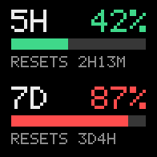

# Claude usage on a Ulanzi Deck

A Ulanzi Studio plugin that shows your Claude plan usage on a deck key: the
5-hour session limit and the weekly limit, each with a percentage, a bar, and a
countdown to the reset.



Bars are green under 50%, amber from 50%, and red from 80%. Pressing the key
checks usage right away and shows how old the numbers are.

## Requirements

- Windows 10 or 11
- Ulanzi Studio 6.1 or later, with a Ulanzi Deck (tested on the D200)
- The Claude Code extension for VS Code, signed in with a Claude Pro or Max plan

## Install

1. Quit Ulanzi Studio.
2. Copy the `com.replica.claudeusage.ulanziPlugin` folder into
   `%APPDATA%\Ulanzi\UlanziDeck\Plugins\`.
3. Start Ulanzi Studio and drag **Claude Usage → Usage Limits** onto a key.

No `npm install` is needed: the plugin's one dependency (`ws`) is included, and
Ulanzi Studio supplies Node.js.

## How it works

Claude Code keeps a copy of your usage in `~/.claude.json`
(`cachedUsageUtilization`). The plugin reads that file and redraws the key
whenever it changes.

Claude Code only refreshes that copy when it looks up your usage, for example
at the start of a session. To keep the key current, the plugin runs the Claude
Code program bundled with the VS Code extension every 5 minutes:

```
claude.exe -p --no-session-persistence /usage
```

`/usage` is a built-in command, so this sends no prompt to the model and uses
none of your quota. `--no-session-persistence` keeps these checks out of your
session history. Checks only run while the key is on screen. To change the
interval, edit `USAGE_CHECK_MS` in `plugin/app.js`.

## Privacy

- The plugin has no network code. Its only connection is the local WebSocket to
  Ulanzi Studio on 127.0.0.1.
- It never reads your Claude login or token.
- The periodic `/usage` check is Claude Code itself asking Anthropic for your
  usage, the same as typing `/usage` in the Claude panel.

## Caveats

`cachedUsageUtilization` and the `/usage` output are internal to Claude Code
and not a documented interface, so a Claude Code update could change them and
break the plugin.

The key image is drawn by the plugin itself (a small PNG encoder and a 5×7
pixel font in `plugin/render.js`), so it needs no image libraries.

## Credits

- `libs/node/` is the Node.js helper library from Ulanzi's plugin SDK, copied
  unchanged.
- `node_modules/ws` is [ws](https://github.com/websockets/ws), MIT licensed.
