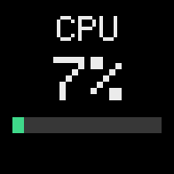

# Claude usage on a Ulanzi Deck

Ulanzi Studio plugins for a Ulanzi Deck. The main one shows your Claude plan
usage on a deck key: the 5-hour session limit and the weekly limit, each with a
percentage, a bar, and a countdown to the reset.

The repo also holds two unrelated plugins:

| Folder | Shows up in Ulanzi Studio as | What it does |
| --- | --- | --- |
| `com.replica.claudeusage.ulanziPlugin` | **Claude Usage** | Claude plan usage |
| `com.replica.speakers.ulanziPlugin` | **Speakers** | Volume dials ([Speaker dials](#speaker-dials)) |
| `com.replica.system.ulanziPlugin` | **System** | CPU, GPU, RAM and disk keys ([System keys](#system-keys)) |


Bars are green under 50%, amber from 50%, and red from 80%. Pressing the key
checks usage right away and shows how old the numbers are.

## Requirements

All plugins need:

- Windows 10 or 11
- Ulanzi Studio 6.1 or later, with a Ulanzi Deck (tested on the D200)

Some need more:

- **Claude Usage**: the Claude Code extension for VS Code, signed in with a
  Claude Pro or Max plan.
- **Speakers**: rear and app volume need NirSoft
  [SoundVolumeView](https://www.nirsoft.net/utils/sound_volume_view.html)
  (see [Speaker dials](#speaker-dials)).
- **System**: the GPU key needs an NVIDIA graphics card and driver.

## Install

The steps are the same for each plugin. Install only the ones you want.

1. Download the repo: on GitHub, click **Code → Download ZIP** and unzip it, or
   run `git clone https://github.com/Replica-/ulanzi-claude-usage.git`.
2. Quit Ulanzi Studio, including its icon in the system tray.
3. Open the plugins folder: press **Win+R**, paste
   `%APPDATA%\Ulanzi\UlanziDeck\Plugins` and press Enter.
4. Copy the plugin's whole folder (for example
   `com.replica.claudeusage.ulanziPlugin`) into that folder. Keep the folder
   name as it is.
5. Start Ulanzi Studio. The plugin appears in the action list on the right.
6. Drag an action onto a key or dial:
   - **Claude Usage → Usage Limits** onto a key.
   - **Speakers → Full Volume**, **Rear Volume** or **Application Volume**
     onto a dial.
   - **System → CPU**, **GPU**, **RAM** or **Disk** onto a key. For a Disk key,
     select it and choose the drive under **Drive** in its settings.

No `npm install` is needed: each plugin includes its one dependency (`ws`), and
Ulanzi Studio supplies Node.js.

### Updating

Quit Ulanzi Studio, replace the plugin's folder with the new one, and start
Ulanzi Studio again. Keys you have already placed keep their settings.

### Uninstalling

Remove the plugin's keys in Ulanzi Studio, quit it, and delete the plugin's
folder from `%APPDATA%\Ulanzi\UlanziDeck\Plugins`.

## How it works

Claude Code keeps a copy of your usage in `~/.claude.json`
(`cachedUsageUtilization`). The plugin reads that file and redraws the key
whenever it changes.

Claude Code only refreshes that copy when it looks up your usage, for example
at the start of a session. To keep the key current, the plugin runs the Claude
Code program bundled with the VS Code extension every 5 minutes:

```
claude.exe -p --no-session-persistence /usage
```

`/usage` is a built-in command, so this sends no prompt to the model and uses
none of your quota. `--no-session-persistence` keeps these checks out of your
session history. Checks only run while the key is on screen. To change the
interval, edit `USAGE_CHECK_MS` in `plugin/app.js`.

## Privacy

- The plugin has no network code. Its only connection is the local WebSocket to
  Ulanzi Studio on 127.0.0.1.
- It never reads your Claude login or token.
- The periodic `/usage` check is Claude Code itself asking Anthropic for your
  usage, the same as typing `/usage` in the Claude panel.

## Caveats

`cachedUsageUtilization` and the `/usage` output are internal to Claude Code
and not a documented interface, so a Claude Code update could change them and
break the plugin.

The key image is drawn by the plugin itself (a small PNG encoder and a 5×7
pixel font in `plugin/render.js`), so it needs no image libraries.

## Credits

- `libs/node/` is the Node.js helper library from Ulanzi's plugin SDK, copied
  unchanged.
- `node_modules/ws` is [ws](https://github.com/websockets/ws), MIT licensed.

## Speaker dials

`com.replica.speakers.ulanziPlugin` adds three dials under **Speakers** (see
[Install](#install)):

  

- **Full Volume**: the normal Windows volume. The dial presses the keyboard
  volume keys (through one hidden PowerShell process), so Windows changes the
  volume and shows its own volume pop-up.
- **Rear Volume**: chosen channels of
  `High Definition Audio Device\Device\Speakers\Render`, rear left and rear
  right (channels 4 and 5) by default. To change them, select the dial in
  Ulanzi Studio and tick the channels under **Channels** in its settings. The
  dial changes every ticked channel by the same step and shows the level of
  the first. Each Rear dial can use different channels.
- **Application Volume**: every instance of the app in front. The dial shows
  the app's name, or NO AUDIO when the app has no sound session.

Each click changes the volume by 2%, and the dial shows the level. Pressing a
dial re-reads it. Rear and app volume use NirSoft
[SoundVolumeView](https://www.nirsoft.net/utils/sound_volume_view.html) from
`C:\development\sound\`. The path, device, default channels and step are constants at
the top of `plugin/volume.js`.

## System keys

`com.replica.system.ulanziPlugin` adds four keys under **System** (see
[Install](#install)):

   

- **CPU**: CPU usage, measured by the plugin from Windows' CPU counters.
- **GPU**: NVIDIA GPU usage, with the temperature underneath, from
  `nvidia-smi` (installed with the NVIDIA driver).
- **RAM**: memory in use, with used and total GB underneath.
- **Disk**: space used on a drive, with the free space underneath. Choose the
  drive in the key's settings in Ulanzi Studio (C by default); each Disk key
  can show a different drive.

They refresh every 2 seconds while on screen, and the bar turns amber from 50%
and red from 80%.
